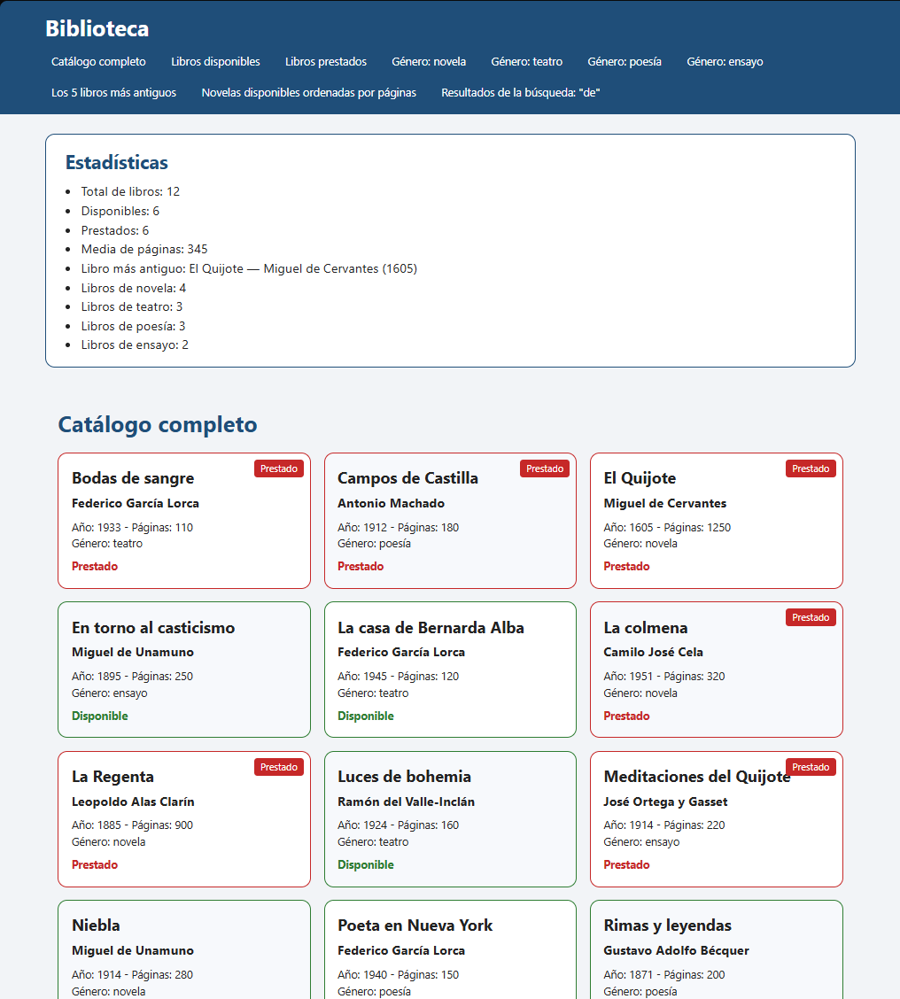
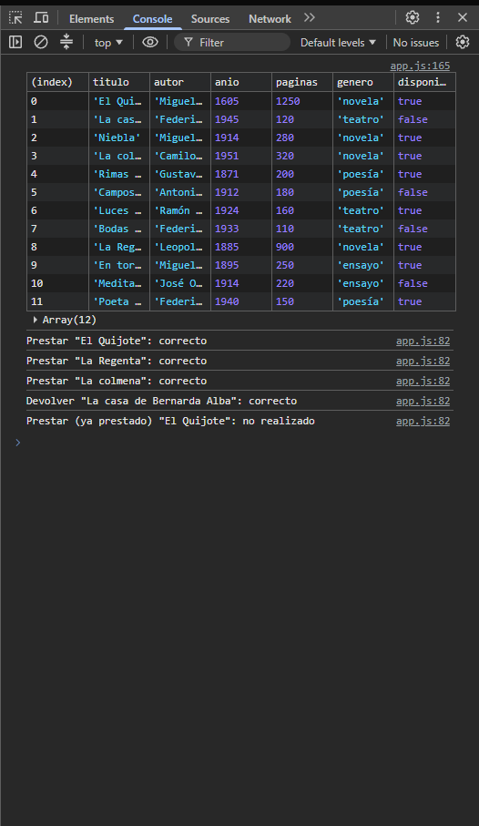
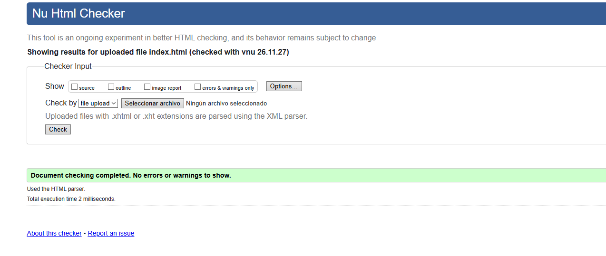

# Proyecto Biblioteca — DEC + DIW (2º DAW)

## Descripción

Página web que muestra el catálogo de una biblioteca en varias vistas (catálogo completo, disponibles, prestados, por género, 5 libros más antiguos, por páginas y búsqueda), con un índice y un panel de estadísticas.

Para ejecutarlo hay que abrir la carpeta con un servidor local (por ejemplo, Live Server de VS Code en el HTML).

## Capturas

- 
- 
- 

## Arquitectura

La aplicación se ejecuta por completo en el cliente, el navegador carga el HTML, la hoja de estilos y los módulos JS, y es JS quien crea las vistas. Los préstamos solo existen en la memoria interna de la página, así que al recargar se pierden. Para guardarlos, se necesitaría de un servidor con una base de datos y una API a la que el cliente enviara cada préstamo o devolución.

Se usa JavaScript porque es el único lenguaje que los navegadores ejecutan de forma nativa para manipular la página.

Al cargar los scripts como módulos (`type="module"`), cada archivo tiene su propio ámbito (sus variables no son globales), se comparten cosas con `export` o `import` y se cargan de forma diferida. Los módulos necesitan un servidor local porque el navegador no permite importar módulos desde `file://`.

Un lenguaje interpretado en el navegador tiene la ventaja de que no hay que compilar ni instalar nada y funciona en cualquier sistema con navegador; como inconvenientes, suele ser más lento que un programa compilado y los errores aparecen al ejecutar, no antes y la posibilidad de realizarse una inyección por código que pertenece a ambos ambitos.

Las herramientas empleadas en el proyecto fueron Visual Studio Code con Live Server para programar, el navegador para probar, las herramientas de desarrollo (consola y pestaña Sources) para depurar y el validador del W3C para el HTML.

## Decisiones

**Cómo combino los filtros.** Los métodos `filtrarPorGenero()` y `filtrarPorDisponibilidad()` devuelven arrays de libros. Para combinar criterios encadeno sobre el array resultante otro `filter()` y un `sort()`. Así, "novelas disponibles ordenadas por páginas" se obtiene filtrando por género `novela`, después por `disponible` y, por último, ordenando por `paginas`. Como cada filtro crea un array nuevo, no se toca el catálogo.

**Cómo ordeno sin modificar el array original.** En `ordenarPor()` primero hago una copia con `[...this.libros]` y ordeno la copia con `sort()`. Si el campo es texto uso `localeCompare()` y si es número, la resta. Para el orden descendente invierto el signo del resultado. El array `this.libros` nunca cambia de orden.

**Cómo convierto los campos en `cargarDesdeTexto()`.** Separo el texto en líneas con `split("\n")` y cada línea en cachitos con `split(";")`. Los textos se limpian con `trim()`, el año y las páginas se convierten con `Number()` y la disponibilidad se convierte en booleano comparando el campo con `si` (sin distinguir mayúsculas). Después se crea un `Libro` y se añade con `agregar()`.
